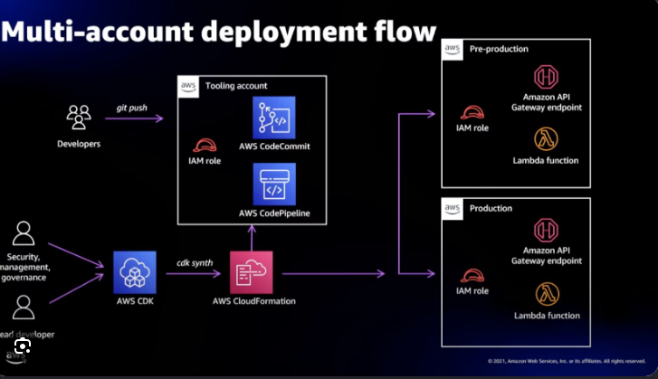
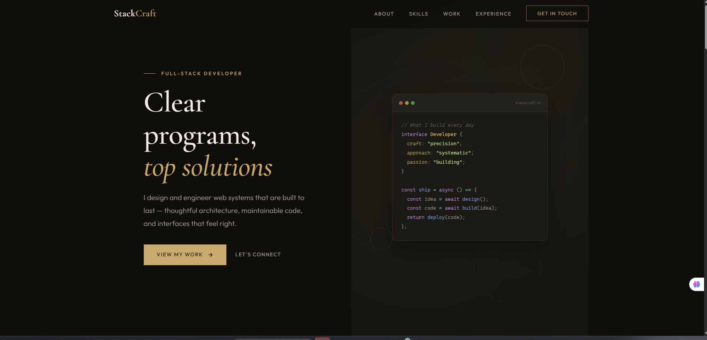
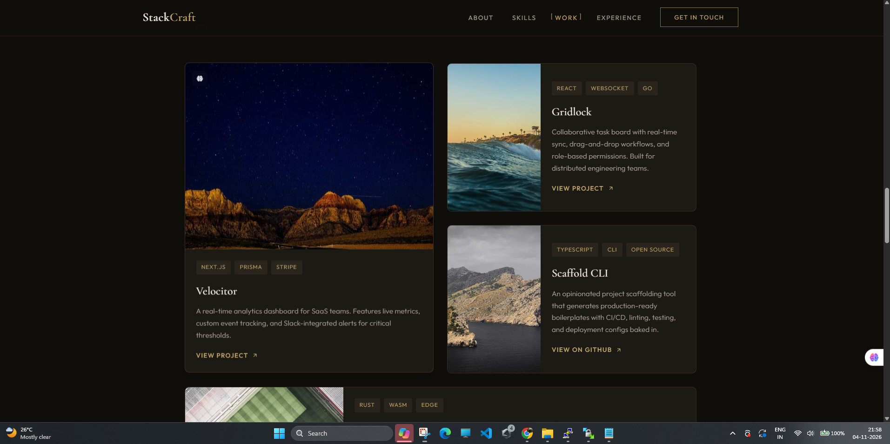
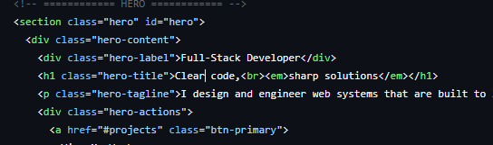
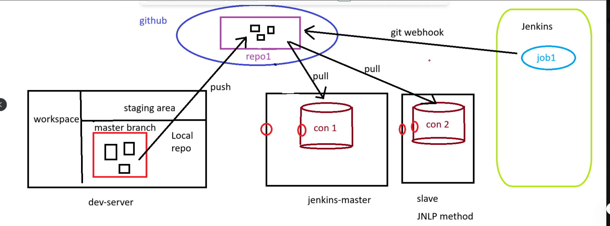
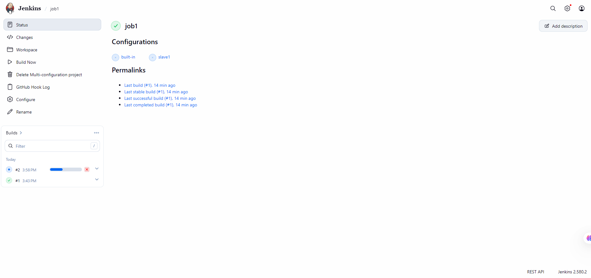
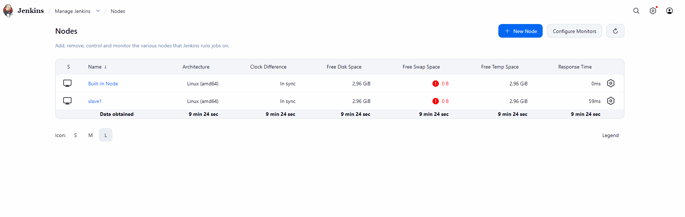
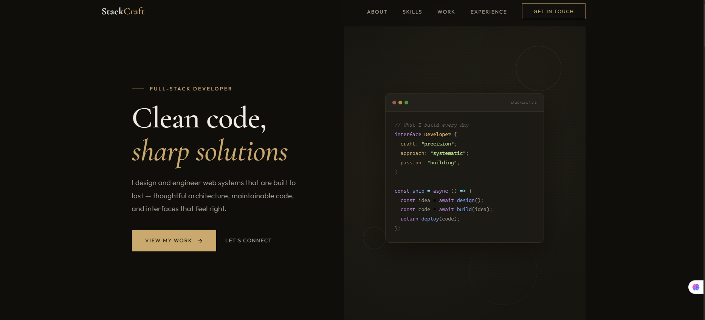

# DevOps Project – Automated Website Deployment with Jenkins, GitHub & Docker

This project demonstrates a basic CI/CD workflow using three Ubuntu EC2 instances:

- **Dev Server** – prepares the website, builds the Docker image context, and pushes the source code to GitHub.
- **Jenkins Master** – receives GitHub webhook notifications, manages the Jenkins job, and coordinates the build.
- **Jenkins Slave (Agent)** – executes the job when the Jenkins job is configured to run on this agent. Docker is installed here so the agent can build and run the container.

> **AMI:** Ubuntu Server 24.04 LTS (HVM), SSD Volume Type  
> **Website:** StackCraft template from Tooplate  
> **Container:** Apache HTTP Server in Docker  
> **Example job:** `job1`  
> **Example container:** `container1`

---

## 1. Project architecture

The architecture below is the primary project flow diagram.



### CI/CD execution flow

1. A developer makes website changes on the **Dev Server**.
2. Git tracks the changes and pushes the source code to the GitHub repository.
3. A configured **GitHub webhook** sends a notification to Jenkins when a push occurs.
4. Jenkins Master receives the webhook and triggers `job1`.
5. Jenkins checks out the latest repository code on the node configured for the job (for example, `slave1`).
6. The job builds a Docker image and starts/replaces the website container.
7. The website is available on the configured host and port.

**Important:** Jenkins Master coordinates the job. If `job1` is configured to run on `slave1`, the checkout/build shell steps execute on the agent. The repository is not automatically cloned independently onto both master and slave; it is checked out on the node where that job runs.

---

## 2. Screenshots

### Website homepage



### Website projects section



### Website HTML source



### GitHub and Jenkins workflow sketch



### Jenkins job configuration



### Jenkins nodes / agent status



### Website after deployment



---

## 3. EC2 instances

Create three EC2 instances using Ubuntu Server 24.04 LTS:

| Instance | Role | Suggested instance type |
|---|---|---|
| `dev-server` | Website development and Git push | `t3.micro` |
| `jenkins-master` | Jenkins controller / webhook receiver | `c7i-flex.large` |
| `jenkins-slave` (`slave1`) | Jenkins build agent and Docker execution | `c7i-flex.large` |

Make sure the master can connect to the agent using the configured Jenkins agent launch method (for example, SSH or inbound agent/JNLP). Configure security groups to allow only the required traffic. Common ports include SSH `22`, Jenkins `8080`, and the demo website port `5000`. Restrict SSH and Jenkins access to trusted IPs wherever possible.

---

## 4. Project files included in this ZIP

```text
devops-jenkins-project/
├── README.md
├── Dockerfile
├── Jenkinsfile                 # Optional Pipeline alternative to the configured Freestyle job
├── .gitignore
├── commands/
│   ├── 01-dev-server.sh
│   ├── 02-jenkins-master.sh
│   ├── 03-jenkins-slave.sh
│   └── 04-jenkins-job-deploy.sh
└── images/
    ├── 01-architecture-overview.png
    ├── 02-website-projects-section.png
    ├── 03-website-homepage.png
    ├── 04-git-jenkins-workflow.png
    ├── 05-jenkins-job1.png
    ├── 06-website-html-source.png
    ├── 07-deployed-website.png
    └── 08-jenkins-nodes.png
```

The `commands/` scripts are reference scripts. Review placeholders and run each script only on the matching server. The `Jenkinsfile` is an optional Declarative Pipeline example; the documented hands-on setup uses Freestyle job `job1` with an Execute shell build step.

## 5. Dev Server setup

### 4.1 Download and extract the website

```bash
cd /root

wget https://www.tooplate.com/zip-templates/stackcraft.zip

apt-get update -y
apt install unzip -y

unzip stackcraft.zip

# Check the folder created by unzip
ls -la
```

Change into the extracted website directory. The exact directory name depends on the ZIP contents:

```bash
cd /root/<extracted-website-folder>
```

### 4.2 Create the Dockerfile

Create a file named `Dockerfile` in the website project root:

```bash
vim Dockerfile
```

Add:

```dockerfile
FROM ubuntu

RUN apt-get update -y
RUN apt-get install -y apache2

COPY . /var/www/html

CMD ["/usr/sbin/apache2ctl", "-D", "FOREGROUND"]
```

Save and exit. The `COPY .` instruction copies the current build context into Apache's web root. Keep the Dockerfile in the same directory that will be used as the Docker build context.

### 4.3 Initialize Git and push to GitHub

Install Git if it is not already installed:

```bash
apt install git -y
```

Initialize the repository and commit the website:

```bash
git init
git add .
git commit -m "Initial commit StackCraft Website"
```

Create a GitHub repository (for example, `webserver-repo`) and connect it:

```bash
git branch -M master
git remote add origin https://github.com/<your-username>/webserver-repo.git
git push -u origin master
```

Replace `<your-username>` with your GitHub username. If the remote already exists, update it with `git remote set-url origin <repository-url>` rather than adding it again.

---

## 6. Jenkins Master setup

Run these commands on the **jenkins-master** Ubuntu instance.

### 5.1 Install Java

```bash
apt update -y
apt install fontconfig openjdk-21-jre -y
java -version
```

### 5.2 Install Jenkins

```bash
mkdir -p /etc/apt/keyrings

wget -O /etc/apt/keyrings/jenkins-keyring.asc \
  https://pkg.jenkins.io/debian-stable/jenkins.io-2026.key

echo "deb [signed-by=/etc/apt/keyrings/jenkins-keyring.asc]" \
  https://pkg.jenkins.io/debian-stable binary/ \
  | tee /etc/apt/sources.list.d/jenkins.list > /dev/null

apt update -y
apt install jenkins -y

systemctl enable --now jenkins
systemctl status jenkins
```

Open Jenkins at:

```text
http://<Jenkins-Master-Public-IP>:8080
```

Retrieve the initial administrator password:

```bash
cat /var/lib/jenkins/secrets/initialAdminPassword
```

Complete the Jenkins browser setup and install the suggested plugins.

### 5.3 Install Git and Docker (if required on the master)

```bash
apt install git docker.io -y
systemctl enable --now docker
```

If Jenkins jobs will execute Docker commands on the master, grant the Jenkins service account Docker access:

```bash
usermod -aG docker jenkins
systemctl restart jenkins
```

A service restart or agent reconnect may be needed after group membership changes. Docker group membership is effectively root-level access; grant it only to trusted accounts.

### 5.4 Sudo permissions

The original setup used `vim /etc/sudoers` and added:

```text
jenkins ALL=(ALL) NOPASSWD: ALL
```

This grants Jenkins unrestricted passwordless sudo and is **not recommended** for a secure setup. Prefer narrowly scoped permissions. If you must edit sudoers, use:

```bash
visudo
```

Do not add broad sudo permissions unless you understand and accept the security risk.

---

## 7. Configure the Jenkins agent (`slave1`)

Run on the **jenkins-slave** Ubuntu instance:

```bash
apt update -y
apt install fontconfig openjdk-21-jre -y
apt install git docker.io -y

systemctl enable --now docker

java -version
git --version
docker --version
```

If the Jenkins agent account needs to run Docker commands, add that account to the Docker group. For an agent account named `ubuntu`, for example:

```bash
usermod -aG docker ubuntu
```

Reconnect/restart the agent session after changing group membership. Use the actual operating-system account configured for the agent.

### Connect the agent in Jenkins

1. Open **Manage Jenkins → Nodes**.
2. Select **New Node** and create a permanent agent named `slave1` (or open the existing node).
3. Configure the remote root directory and the required number of executors.
4. Select the launch method that matches your setup (SSH or inbound agent).
5. Save and confirm that the agent is online.
6. In the job configuration, restrict the job to `slave1` if you want the build to execute there.

The Jenkins Nodes screenshot above shows the built-in node and `slave1`.

---

## 8. Configure the GitHub webhook

In the GitHub repository:

1. Open **Settings → Webhooks → Add webhook**.
2. Set the Payload URL to:

```text
http://<jenkins-master-public-ip>:8080/github-webhook/
```

3. Set content type to `application/json`.
4. Select the push event (or the events required by your workflow).
5. Save the webhook.

Ensure the Jenkins master is reachable from GitHub on port `8080`. For a production setup, use HTTPS and restrict inbound access appropriately.

---

## 9. Create Jenkins job `job1`

Create a Freestyle project named `job1`.

### 8.1 Source Code Management

- Select **Git**.
- Enter the GitHub repository URL:

```text
https://github.com/<your-username>/webserver-repo.git
```

- Set the branch specifier to:

```text
*/master
```

- Configure Git credentials if the repository is private.

### 8.2 Build Triggers

Enable the GitHub webhook trigger option shown in your Jenkins installation, commonly:

- **GitHub hook trigger for GITScm polling**

The webhook notifies Jenkins; the Git plugin checks for changes and the job is scheduled when a new commit is detected.

### 8.3 Restrict the job to the agent (optional)

Under **General**, enable **Restrict where this project can be run** and enter:

```text
slave1
```

Use the exact node label configured in Jenkins. If you leave this unchecked, Jenkins may choose any eligible node according to its configuration.

### 8.4 Build Steps → Execute shell

Use this shell script to replace the previous container and deploy the new image:

```bash
sudo docker rm -f container1 || true

sudo docker build -t webserver-image .

sudo docker run -d --name container1 -p 5000:80 webserver-image
```

This assumes the checked-out workspace contains the `Dockerfile` at its root and Docker is available on the node executing the job.

Run the job manually once using **Build Now** to verify the initial setup. After the first successful build, test the webhook by pushing another commit.

Access the website at:

```text
http://<Jenkins-Master-Public-IP>:5000
```

**If the job runs on `slave1`:** the container is running on the slave, so the public IP used to access the website should normally be the **slave's public IP**, not the master's. Alternatively, expose the service through a load balancer or proxy. Ensure the security group for the host running Docker allows the required inbound port `5000`.

---

## 10. Test automatic deployment

After opening the deployed website, make a small change to a website file on the Dev Server. For example:

```bash
vim index.html
```

Then commit and push:

```bash
git add .
git commit -m "Updated index.html"
git push origin master
```

Expected result:

1. GitHub receives the new commit.
2. GitHub sends a webhook notification to Jenkins.
3. Jenkins triggers `job1`.
4. Jenkins checks out the latest code on the configured build node.
5. The shell step rebuilds the Docker image.
6. The old `container1` is removed and a new container starts.
7. Refresh the website URL to see the updated page.

---

## 11. Useful verification commands

```bash
# Jenkins service
systemctl status jenkins
journalctl -u jenkins -f

# Docker service
systemctl status docker
docker ps -a
docker images

# Check whether the website container is running
docker logs container1

# Check listening ports
ss -tulnp

# Check Git remote and branch
git remote -v
git branch
git status
```

---

## 12. Troubleshooting checklist

| Issue | What to check |
|---|---|
| Webhook does not trigger Jenkins | GitHub webhook delivery status, Jenkins URL, port `8080`, and GitHub hook trigger setting |
| Job runs on built-in node instead of `slave1` | Job label restriction, agent online status, and node label |
| `docker: permission denied` | Docker installed on the actual build node; agent account has Docker access; reconnect agent |
| `Cannot connect to the Docker daemon` | Run `systemctl status docker` on the node executing the build |
| Docker build cannot find `Dockerfile` | Confirm the Dockerfile is in the Git repository root / Jenkins workspace |
| Website does not load on port `5000` | Confirm container status, port mapping, and inbound security-group rule on the Docker host |
| Latest changes are not visible | Confirm the push succeeded, job checked out the intended branch, build succeeded, and container was recreated |

---

## 13. Project summary

**Tools and technologies used**

- AWS EC2
- Ubuntu Server 24.04 LTS
- Git and GitHub
- GitHub Webhooks
- Jenkins Master and Jenkins Agent (`slave1`)
- Docker
- Apache HTTP Server
- HTML, CSS and JavaScript website

**Outcome:** A Git push from the Dev Server can automatically trigger a Jenkins job through a GitHub webhook. Jenkins checks out the updated source code on the configured build node, builds a Docker image, and deploys the website in a container.

---

## Author

Add your name, GitHub profile, and repository URL here.
